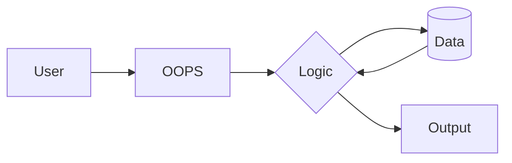

# Object-Oriented Programming in Java

A structured collection of **Java** programs covering language fundamentals and core OOP concepts, organized from basics to advanced topics.

## Architecture / How it Works




---

## Contents

| Folder | Description | Key Concepts |
|--------|-------------|--------------|
| **BASIC/Basic** | Java language fundamentals (13 files) | Variables, data types, operators, strings, type casting, math operations |
| **BASIC/DataType** | Data type deep dive (6 files) | Primitive types, non-primitive types, booleans, characters, numbers |
| **BASIC/Methods** | Method concepts and patterns (6 files) | Method declaration, parameters, return values, overloading, scope, recursion |
| **BASIC/OOP** | Core OOP principles (5 files) | Inheritance, encapsulation, polymorphism, abstraction, class blueprints |

---

## Topic Breakdown

### Java Basics

| File | Topic |
|------|-------|
| HelloWorld.java | First Java program |
| Variables.java | Variable declaration and initialization |
| PrintVariables.java | Outputting variable values |
| MultipleVariables.java | Working with multiple variables |
| Identifiers.java | Naming conventions and rules |
| Operator.java | Arithmetic, relational, and logical operators |
| Strings.java | String manipulation |
| SpecialCharacters.java | Escape sequences and special characters |
| TypeCasting.java | Implicit and explicit type conversion |
| Math.java | Math class utilities |
| RealLifeExample.java | Practical application of basics |

### Data Types

| File | Topic |
|------|-------|
| DataType.java | Overview of all data types |
| Numbers.java | Integer and floating-point types |
| Booleans.java | Boolean logic |
| Characters.java | Character type and operations |
| NonPrimitiveType.java | Arrays, strings, objects |
| RealLifeExample.java | Practical data type usage |

### Methods

| File | Topic |
|------|-------|
| Method.java | Basic method syntax |
| ParametersMethrod.java | Passing arguments to methods |
| ReturnValue.java | Returning values from methods |
| OverloadingMethod.java | Method overloading |
| Scope.java | Variable scope rules |
| Recursion.java | Recursive method calls |

### OOP Principles

| File | Topic |
|------|-------|
| BluePrint.java | Classes as blueprints for objects |
| InheritanceExample.java | Extending classes and code reuse |
| EncapsulationExample.java | Data hiding with getters/setters |
| PolymorphismExample.java | Method overriding and dynamic dispatch |
| AbstractionExample.java | Abstract classes and interfaces |

---

## Prerequisites

- JDK 8 or later
- Any Java IDE (IntelliJ IDEA, Eclipse, VS Code) or command-line compiler

## How to Use

1. Clone the repository:
   ```bash
   git clone https://github.com/ALPHAMAN-0/OOPS.git
   ```
2. Navigate to a topic folder and compile:
   ```bash
   cd BASIC/OOP
   javac InheritanceExample.java
   java InheritanceExample
   ```
3. Work through folders in order: Basic -> DataType -> Methods -> OOP for a structured learning path.
